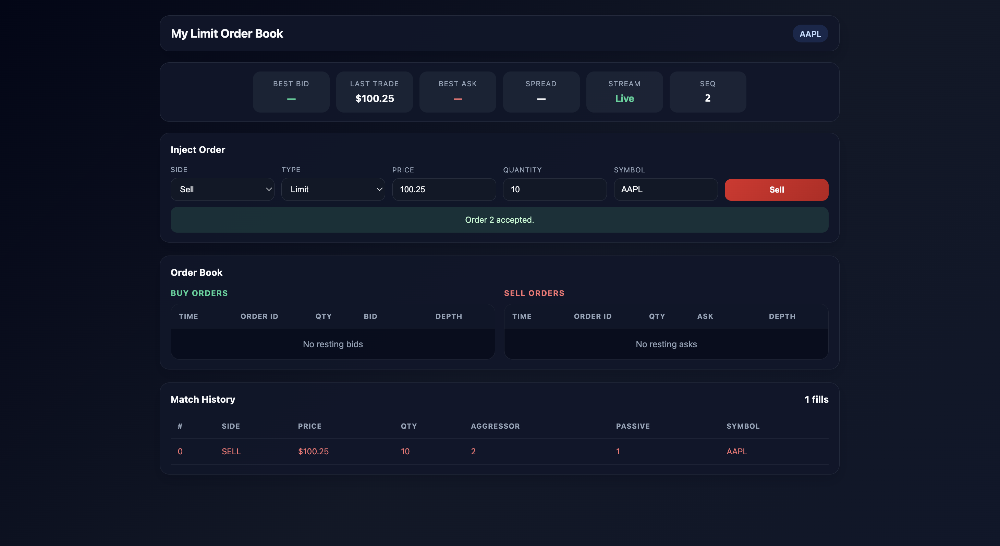
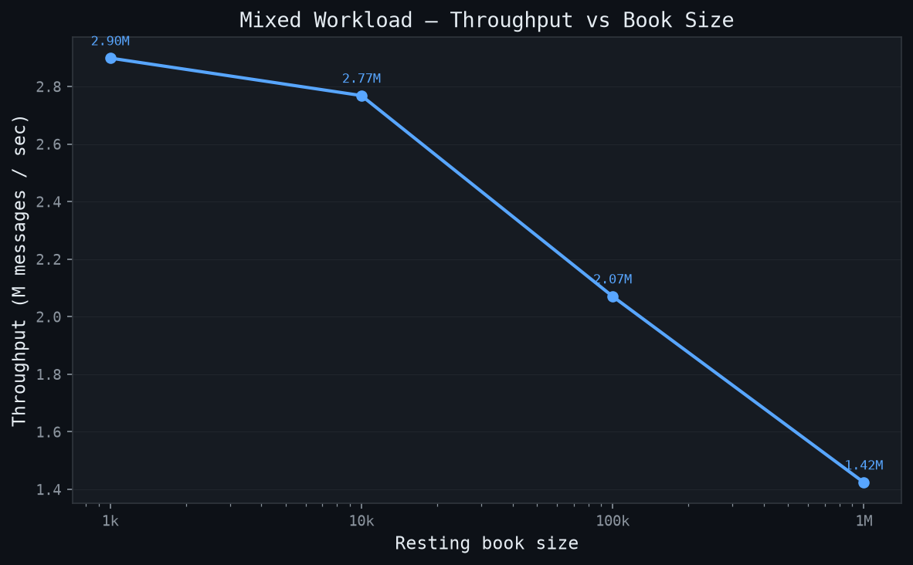
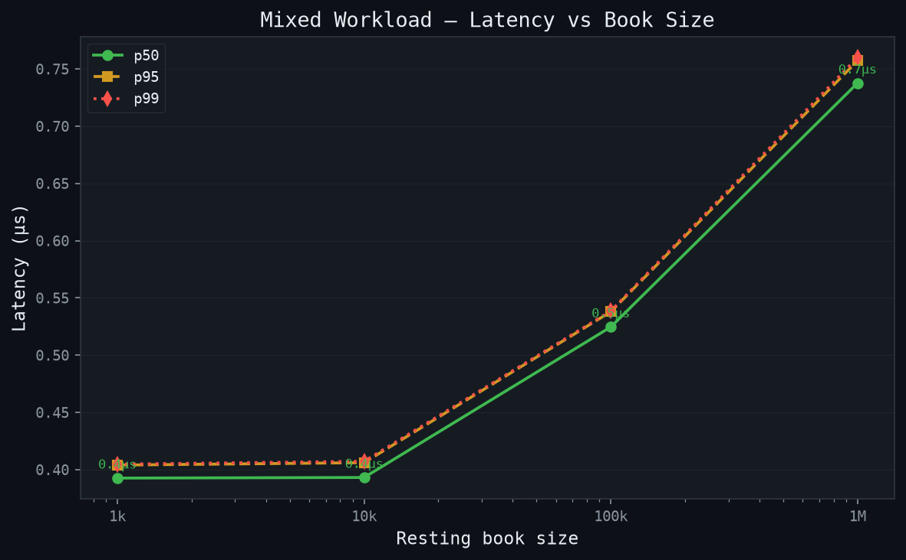
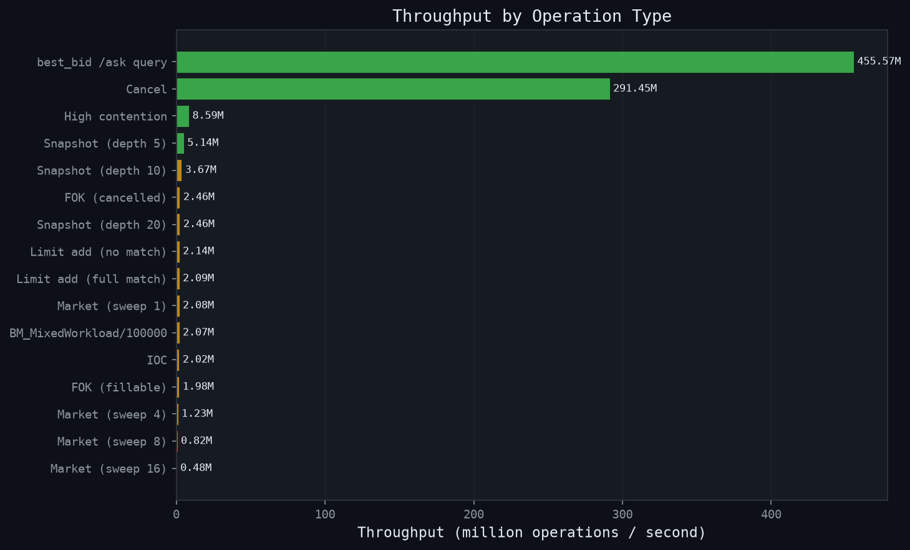
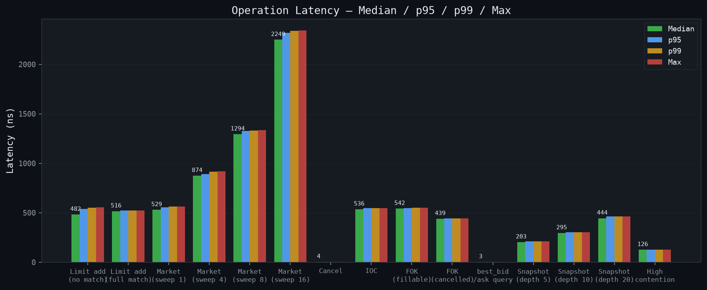

# [Limit Order Book Engine](https://order-book-indol.vercel.app/)

[](https://github.com/aluaz721/order-book/actions/workflows/ci.yml)

A high-performance limit order book engine written in C++17, exposed to Python via pybind11 and driven by a FastAPI backend with a React dashboard for interactive simulation.

The core engine implements price-time priority FIFO matching against a red-black tree order book (`TreeOrderBook`). Orders submitted through the dashboard are matched by this engine — the API layer translates and serialises, but owns no matching logic of its own.

The architecture separates three concerns behind abstract interfaces — book storage (`OrderBookInterface`), per-level order storage (`PriceLevelInterface`), and intra-level fill allocation (`MatchingAlgorithm`) — so that each can vary independently. One implementation of each is built and tested: `TreeOrderBook`, `LinkedListPriceLevel`, and `FIFOMatcher`. Second implementations along two of those axes are designed but not built; see [Known gaps](#known-gaps).

Live URL: https://order-book-indol.vercel.app/

**Mixed workload · 100k resting orders**
 
| Metric | Value |
|---|---|
| Throughput | 2.07M msgs/s |
| p50 latency | 0.5246 µs |
| p95 latency | 0.5379 µs |
| p99 latency | 0.5386 µs |
| max latency | 0.5387 µs |
| Workload mix | 40% passive limit · 35% cancel · 20% market · 5% IOC |
 
---

## Tech Stack
### Languages & Build


 
### Frameworks & Libraries


 
### Containers & Infra


## Repo Layout
```text
cpp/                        # C++17 engine — compiled as a static library
  include/order_book/
    core/                   # Fundamental types: Order, Side, OrderType, events, price utils
    book/                   # Abstract OrderBookInterface + TreeOrderBook (built)
                            #   + VectorOrderBook (declared, throws — see Known gaps)
    matching/               # Abstract MatchingAlgorithm + FIFOMatcher (built)
                            #   + ProRataMatcher (header only — see Known gaps)
    orders/                 # StopOrderManager, OrderValidators
    sources/                # OrderSource interface: InteractiveSource, HistoricalReplayer, StrategySource
    engine/                 # SimulationEngine — priority-queue merge of all sources
  src/                      # Implementations corresponding to each header above
  tests/                    # GoogleTest suite (118 tests): book, engine, stop manager, replayer
  benchmarks/               # Google Benchmark suite; output consumed by scripts/plot_benchmarks.py
 
bindings/python/            # pybind11 module source (order_book_bindings.cpp), compiled into
                            #   python/order_book/_order_book.*.so at build time
 
tests/                      # pytest suite (48 tests) for the order_book Python package
 
pyproject.toml              # scikit-build-core config — `pip install .` builds the pybind11 extension
 
python/
  order_book/               # The importable Python package (see "Python Library" above)
    __init__.py             #   re-exports the compiled _order_book submodule at the top level
    session.py              #   Session — engine + book + order queue for one symbol, all 7 types
    _order_book/            #   type stubs for the compiled extension (regenerate via pybind11-stubgen)
    py.typed                #   PEP 561 marker
    features/
      microstructure.py     #   pure functions over BookSnapshot/FillEvent — no live book needed
  backend/
    app/
      main.py               #   FastAPI routes: REST endpoints + WebSocket book stream
      services.py           #   EngineBridge — adapter onto the C++ TreeOrderBook
      models.py             #   Pydantic wire models
    tests/                  #   pytest suite (42 tests) against the real engine
  .venv/
 
frontend/
  src/                      # React + Recharts dashboard (Vite)
 
scripts/
  plot_benchmarks.py        # Reads docs/bench_raw.json → writes figures to docs/bench_figures/
 
docs/
  bench_raw.json            # Raw Google Benchmark JSON output
  bench_figures/            # Generated plots (latency histograms, throughput, CDFs)
  dashboard.png             # Dashboard screenshot
 
.github/workflows/
  ci.yml                    # runs on every push/PR: C++ tests, both pytest suites,
                            #   frontend build, and a smoke test of the backend image
  wheels.yml                # cibuildwheel — portable wheels on tags or manual trigger
```

---
 
## Architecture

There are two ways into the engine. The dashboard takes the first; a full
simulation (historical replay, strategies, stop orders) takes the second.

```
1. Dashboard path  (what the live demo runs)
────────────────────────────────────────────
React (Vite)                         Python                         C++
  │  POST /orders                      │                              │
  ├────────────────────────────────────►│  EngineBridge                │
  │  DELETE /orders/{id}                │   ├─ float $ → int64 bp      │
  │                                     │   ├─ serialise under a lock  │
  │                                     │   ├─ book.add() ────────────►│ TreeOrderBook
  │                                     │   │                          │   ├─ FIFOMatcher
  │                                     │   │  on_fill / on_cancel     │   ├─ bids_ / asks_
  │                                     │   │  on_ack / on_book_update◄┤   └─ order_map_
  │                                     │   │         │                │
  │                                     │   │   record_trade()         │
  │                                     │   ▼         ▼                │
  │                                     │  StopOrderManager            │
  │                                     │   └─ drain_triggers() ──────►│ (converted order)
  │  ◄═══ WebSocket /ws/book ═══════════┤                              │
  │       (book + fills + pending stops)│                              │

   EngineBridge owns no matching logic. It translates vocabulary, serialises
   access (OrderBookInterface is not thread-safe), and projects the per-order
   metadata the engine deliberately doesn't model — submission time, order
   type, per-level order IDs — from the engine's own callback stream.

   All seven order types are available here. STOP and STOP_LIMIT never reach
   the book: the bridge owns a StopOrderManager that holds them until a trade
   crosses their price. Each fill only *records* the trade (the book is
   mid-match inside its own callback); the bridge drains the recorded trades
   once `add()` has returned, which is when a triggered stop's converted
   order enters the book. Pending stops ride in the WebSocket snapshot
   alongside the book, since by design they are absent from its depth.

2. Simulation path  (reachable from C++ and from Python)
──────────────────────────────────────────────────────
InteractiveSource ──┐
HistoricalReplayer ──┼──► SimulationEngine ──► OrderBook ──► FillEvent
StrategySource    ──┘          │                               │
                               │◄──────── BookSnapshot ────────┘
                               │
                      StopOrderManager
                      ├── stop_buys_   (std::map ascending)
                      └── stop_sells_  (std::map descending)

   This is the only route to STOP and STOP_LIMIT: the book itself throws on
   them, because a stop is a conditional trigger rather than a resting order
   and must not appear in visible depth. SimulationEngine::dispatch() routes
   them to StopOrderManager instead, which holds them until a trade crosses
   their stop price.

   Each fill is reported to the manager with record_trade(); the orders any
   crossed stops convert into are submitted by drain_triggers(), which
   dispatch() calls once the book operation has returned. The split matters:
   submitting from inside the fill callback would re-enter OrderBook::add()
   while it is still sweeping price levels. A cascade — a triggered stop whose
   fill crosses another stop — is drained iteratively in that one loop.
```

```
Data structures (TreeOrderBook)
───────────────────────────────
bids_     std::map<int64_t, LinkedListPriceLevel, std::greater>   O(log L) lookup
asks_     std::map<int64_t, LinkedListPriceLevel>                  O(1) best ask
order_map_  std::unordered_map<order_id, {side, price, iterator}>  O(1) cancel
```
 
---
 
## Engine API
 
**Supported order types**
 
| Type | Behaviour |
|---|---|
| `LIMIT` | Rests in book at specified price if not immediately matchable |
| `MARKET` | Fills at any price; remainder cancelled if insufficient liquidity |
| `MARKET_LIMIT` | Like MARKET but unfilled remainder rests at last traded price |
| `STOP` | Triggers as MARKET when last trade price crosses stop price |
| `STOP_LIMIT` | Triggers as LIMIT at `limit_price` when stop price is crossed |
| `IOC` | Immediate-or-cancel: fill what's available, cancel remainder |
| `FOK` | Fill-or-kill: fill entire quantity or cancel without any partial fills |

All seven are reachable from every surface: C++ directly, Python via
[`order_book.Session`](#python-library), and the dashboard's order form.
`STOP` and `STOP_LIMIT` are the two that never touch `OrderBookInterface
::add()` — they are held by a `StopOrderManager` until a trade crosses their
price, so whichever surface submits one needs that manager behind it.
 
**Key interfaces**
 
```cpp
// Construct with any combination of book implementation + matching algorithm
TreeOrderBook book("AAPL", std::make_unique<FIFOMatcher>(), callbacks);
 
// Core operations — all O(log L) where L = distinct price levels
book.add(order);              // match then rest, or cancel per order type
book.cancel(order_id);        // O(1) hash map lookup + O(1) list erase
book.execute(order_id, qty);  // feed-driven partial/full fill
book.replace(old_id, order);  // atomic cancel + add (new order loses time priority)
 
// O(1) queries
book.best_bid();              // std::optional<int64_t>  — basis points
book.best_ask();
book.spread();
book.mid_price();
book.weighted_mid();
 
// Snapshot for Python / WebSocket
BookSnapshot snap = book.snapshot(depth);   // top-N levels each side
```
 
**Prices are int64_t in basis points** (1 unit = $0.0001) throughout the engine to eliminate floating-point rounding errors. Use 'order_book::to_basis_points(double)` and `order_book::from_basis_points(int64_t)` for conversion.
 
**Callbacks** are registered at construction via `OrderBookCallbacks` and fired synchronously:
 
```cpp
OrderBookCallbacks cbs;
cbs.on_fill        = [](const FillEvent&)    { /* every match */ };
cbs.on_cancel      = [](const CancelEvent&)  { /* IOC/FOK/explicit cancel */ };
cbs.on_ack         = [](const AckEvent&)     { /* once per submitted order */ };
cbs.on_book_update = [](const BookSnapshot&) { /* after every state change */ };
```
 
---

## Python Library

The C++ engine is importable as a Python package (`order_book`) via [pybind11](bindings/python/order_book_bindings.cpp), built with [scikit-build-core](https://scikit-build-core.readthedocs.io/) so a normal `pip install` compiles the extension for you — no separate CMake invocation needed. Check out `order_book_demo.ipynb` in python/ to see the Python library in use.

**Install**

```bash
pip install .                                          # from the repo root
pip install "order-book @ git+https://github.com/aluaz721/order-book.git"  # as a dependency elsewhere
```

For local development against another project (e.g. a backtesting library depending on this one), install it editable so changes rebuild without reinstalling:

```bash
pip install -e . --no-build-isolation
```

`order_book` is a real Python package (`python/order_book/`): the compiled pybind11 extension lives inside it as the private `_order_book` submodule and is re-exported at the top level, alongside pure-Python additions like `order_book.features` and `order_book.Session`. Type stubs (the `_order_book/` stub package + a `py.typed` marker) ship in the wheel next to the compiled extension, so IDEs and mypy/pyright get full signatures out of the box. Regenerate them after changing the bindings with `pybind11-stubgen order_book._order_book -o <tmp-dir>` and copy the result over `python/order_book/_order_book/`.

There are two levels to the library. `Session` is the ergonomic one — it owns an engine, a book and an order queue for one symbol, takes dollar prices, and accepts all seven order types. The bound classes underneath mirror the C++ API exactly (int64 basis points, explicit sources, ownership transfer on construction) and are what `Session` is built from; drop down to them via `Session.engine` / `Session.book` whenever you want the real thing.

**Quickstart — Session**

```python
import order_book as ob

s = ob.Session("AAPL")

s.limit("sell", 100, 150.50)          # rests
s.limit("buy",  100, 149.50)          # rests
s.stop("sell",   50, stop_price=149.00)   # held outside the book

s.pending_stops            # 1  — not in the book, so not in the depth either
s.best_bid(), s.best_ask() # (149.5, 150.5)

s.limit("buy", 200, 148.50)
result = s.limit("sell", 150, 148.00)     # sweeps 149.50, then 148.50

result.filled_quantity     # 150 — what this order traded
result.traded_quantity     # 200 — including the stop it fired on the way down
result.triggers[0].converted_to   # OrderType.MARKET
s.pending_stops            # 0
```

Every submission returns an `OrderResult` carrying the events it caused — its own fills, any cancellation of its remainder, and any stop it triggered — plus the engine's acknowledgement, so a rejection is a value to inspect rather than an exception to catch:

```python
s.fok("buy", 10_000, 150.50).rejected    # True
s.fok("buy", 10_000, 150.50).message     # 'FOK cannot be fully filled: shortfall of ...'
s.stop("sell", 50, stop_price=160.00).message
# 'stop-sell price must be below the current market to avoid triggering immediately'
```

Submissions drain the engine immediately; pass `run=False` to queue a batch and `s.run()` to process it. `s.cancel(order_id)` removes a resting order or a stop that has not fired yet — a pending stop lives in the `StopOrderManager`, not the book, so it is cancelled there.

**Quickstart — the bound engine directly**

```python
import order_book as ob

book = ob.TreeOrderBook("AAPL", ob.FIFOMatcher())

book.add(ob.Order(id=1, symbol="AAPL", side=ob.Side.BID, type=ob.OrderType.LIMIT,
                  price=ob.to_basis_points(150.00), quantity=100, timestamp=1))
book.add(ob.Order(id=2, symbol="AAPL", side=ob.Side.ASK, type=ob.OrderType.LIMIT,
                  price=ob.to_basis_points(150.00), quantity=40, timestamp=2))

print(book.best_bid(), book.total_bid_qty())  # 1500000 60
```

Stops need the engine, since `TreeOrderBook.add()` refuses them by design. Submit through an `InteractiveSource` and `run()` to drain — the engine returns as soon as its live sources are empty, so "submit, run, inspect" is the whole loop:

```python
config = ob.SimulationConfig()
config.symbol = "AAPL"

engine = ob.SimulationEngine(config, ob.TreeOrderBook("AAPL", ob.FIFOMatcher()))
engine.add_source(ob.InteractiveSource())
engine.set_trigger_callback(lambda t: print("fired", t.stop_order_id, t.converted_to))

ui = engine.interactive_source()
ui.submit(ob.Order(id=1, symbol="AAPL", side=ob.Side.ASK, type=ob.OrderType.STOP,
                   price=ob.to_basis_points(149.00), quantity=50))
engine.run()

stops = engine.stop_manager()
stops.pending_stop_count()   # 1
stops.nearest_stop_sell()    # 1490000 — the next to fire as the market falls
stops.cancel(1, 0)           # pending stops are cancelled here, not in the book
```

**Strategy callbacks** — `StrategySource` invokes a Python callable on every book update and feeds the orders it returns back into the engine on the following tick. The one-tick delay is deliberate: it stops a strategy filling against the very snapshot it reacted to. Orders may be of any type, stops included.

```python
def quote(snapshot, timestamp):
    if not snapshot.asks:
        return []
    return [s.make_order("buy", "limit", 25,
                         ob.from_basis_points(snapshot.asks[0].price) - 0.10)]

s = ob.Session("AAPL", strategy=quote)
s.limit("sell", 100, 150.00)
s.best_bid()        # 149.9 — the strategy joined the book
```

A callback that returns an order on every invocation feeds itself forever, since each resulting book update invokes it again; return an empty list when there is nothing to do. `Session.make_order()` assigns the order id the engine requires — unlike the interactive queue, `StrategySource` does not fill one in.

**Pre-validating an order** — `order_book.validators` exposes the same checks the engine runs, so a Python risk layer can get the verdict (and the message) before submitting:

```python
order = s.make_order("buy", "fok", 500, 150.50)
verdict = ob.validators.validate(order, s.book)      # or s.validate(order)
verdict.valid, verdict.reason
```

**Replaying historical data** — `HistoricalReplayer` reads NASDAQ ITCH 5.0 files (the flat, length-prefixed framing used by NASDAQ's downloadable samples) and feeds them through `SimulationEngine` in timestamp order:

```python
config = ob.SimulationConfig()
config.symbol = "AAPL"

engine = ob.SimulationEngine(config, ob.TreeOrderBook("AAPL", ob.FIFOMatcher()))
engine.set_fill_callback(lambda fill: print(fill.fill_price, fill.fill_quantity))

replay_config = ob.HistoricalReplayerConfig()
replay_config.path = "01302020.NASDAQ_ITCH50"
replay_config.symbol_filter = "AAPL"  # empty = replay every symbol in the file
engine.add_source(ob.HistoricalReplayer(replay_config))

engine.run()
print(engine.orders_processed(), engine.book().best_bid())
```

**Ownership note:** objects passed into another object's constructor or `add_source()`/`set_matching_algorithm()` (a matcher into a book, a book into an engine, a source into an engine) transfer ownership via `unique_ptr`, matching the C++ API. The original Python object becomes an empty shell afterwards — use the owner's accessors instead (`engine.book()`, `engine.interactive_source()`, `engine.historical_replayer()`, `engine.strategy_source()`, `engine.stop_manager()`), not the variable you originally constructed. `Session` exposes the same handles as properties.

**Microstructure features** — `order_book.features.microstructure` computes standard order-book statistics directly from a `BookSnapshot`/`FillEvent`, with no live book or engine reference required. This is intentionally scoped to pure functions of book/fill state (mid price, spread, queue-imbalance-weighted microprice, order book imbalance, VWAP-to-fill, price impact, effective spread) — strategy logic, ML models, and alternative data (sentiment, macro) are out of scope for this repo and belong in a downstream backtesting/analytics project instead:

```python
from order_book.features import microstructure as ms

snap = book.snapshot()
ms.mid_price(snap)                              # simple mid
ms.micro_price(snap)                             # queue-imbalance-weighted mid
ms.order_book_imbalance(snap, max_levels=5)      # (bid_depth - ask_depth) / total, top 5 levels
ms.price_impact(snap, ob.Side.BID, quantity=500) # est. slippage for a hypothetical market buy
```

**Python tests**

```bash
pip install -e ".[test]" --no-build-isolation
pytest
```

---
 
## Build, Run, and Visualize
 
<figure>
  
  <figcaption>Locally hosted dashboard for interactive order injection and live book visualisation.</figcaption>
</figure>

### Docker
 
```bash
docker compose up --build
```
 
- Backend API: http://localhost:8000
- Frontend:    http://localhost:5173

The `docker compose` build compiles the C++ extension inside the image — see
[Deployment](#deployment) below.

### Without Docker

The backend imports the compiled engine, so it has to be installed into the
same environment that runs uvicorn — `pip install -e .` from the repo root
builds the pybind11 extension and makes `import order_book` work.

```bash
# 1. Build and install the engine as a Python package (compiles the extension)
python3 -m venv .venv && source .venv/bin/activate
pip install -e . --no-build-isolation

# 2. Backend
pip install -r python/backend/requirements.txt
cd python/backend
uvicorn app.main:app --reload --host 127.0.0.1 --port 8000

# 3. Frontend (separate terminal)
cd frontend
npm install
npm run dev
```

To build the C++ targets (tests, benchmarks) directly without going through
Python packaging:

```bash
cmake -B build -DCMAKE_BUILD_TYPE=Release
cmake --build build -j$(nproc)
```
 
### Deployment

The backend deploys as a free Docker web service on **Render**; the frontend deploys as a free static site on **Vercel**.

**Backend — Render**
1. Push this repo to GitHub.
2. Render dashboard → New → Blueprint → connect the repo. Render reads [`render.yaml`](render.yaml) and provisions `order-book-backend` as a free Docker web service (no config needed).
3. Copy the deployed URL, e.g. `https://order-book-backend.onrender.com`.
   - The free plan spins down after ~15 min idle; the next request takes 30-60s to wake it back up.

The [`Dockerfile`](Dockerfile) is a two-stage build: the first stage installs
`build-essential` + `cmake` and compiles the engine into a wheel, the second
installs just that wheel into a clean `python:3.12-slim` runtime (no compiler
in the final image, ~260 MB). The builder needs network access for CMake's
`FetchContent` to pull pybind11, and `ORDER_BOOK_BUILD_TESTS`/`BENCHMARKS` are
`OFF` in `pyproject.toml` so GoogleTest and Google Benchmark are not fetched
during an image build. The runtime stage ends with an `import order_book`
check, so a broken extension fails the build rather than the first request.

**Frontend — Vercel**
1. Vercel dashboard → New Project → import the same repo.
2. Set **Root Directory** to `frontend` (Vercel auto-detects the Vite preset — build command and output directory need no changes).
3. Add an environment variable `VITE_API_BASE` set to the Render URL from above, with no trailing slash.
4. Deploy.

Locally via `docker compose up`, leave `VITE_API_BASE` unset — the Vite dev server proxies `/orders`, `/fills`, `/backtests`, `/health`, `/diagnostics`, and `/ws` straight to the `backend` container, so nothing else changes.

### Tests

**C++ — 118 GoogleTest cases.** 63 cover the book itself (all order types,
matching, cancel, the FOK pre-check, IOC semantics, snapshot correctness,
sequence monotonicity); 29 cover the `SimulationEngine` (each of the seven
order types end to end, stop validation, source draining and ordering,
the strategy feedback loop, heap bookkeeping, lifecycle and statistics);
17 cover the `StopOrderManager` (submission and rejection, trigger conditions
on both sides, STOP vs STOP_LIMIT conversion, cascades, cancellation); 9 cover
the ITCH replayer (full order lifecycle, symbol filtering, the time window,
skipping non-order message types, and each replay speed — including that
REALTIME doesn't stall on the first event's absolute timestamp or on a file
whose timestamps go backwards).

```bash
cmake -B build -DCMAKE_BUILD_TYPE=Release
cmake --build build -j$(nproc)
ctest --test-dir build --output-on-failure
```

**Python package — 48 pytest cases** covering the binding layer (signatures,
ownership transfer, callback wiring, the stop path, the strategy callback,
validators), the `Session` façade organised by order type, and the
microstructure helpers:

```bash
pip install -e ".[test]" --no-build-isolation
pytest                      # runs ./tests, per pyproject's testpaths
```

**Backend — 42 pytest cases** driving `EngineBridge` and the HTTP/WebSocket
surface against the real compiled engine, not a stand-in. These are what
catch a regression in the float↔basis-point conversion, the FIFO ordering the
UI displays, or a projection that drifts from the engine's own book state —
including through a stop trigger, where the order that enters the book is one
the client never submitted.

```bash
cd python/backend
python -m pytest            # needs `order_book` importable (pip install -e .)
```

### Continuous integration

[`.github/workflows/ci.yml`](.github/workflows/ci.yml) runs on every push and
pull request, in four parallel jobs:

| Job | What it does |
|---|---|
| **C++ engine** | Configures Release, builds the library, the GoogleTest suite and the benchmark binary, then runs `ctest`. Benchmarks are compiled but not run — timings from a shared runner are meaningless, but a benchmark that no longer compiles against the engine API is a real regression. |
| **Python** | Installs the package the way a consumer would (`pip install ".[test]"`, which compiles the extension), asserts `import order_book` works, then runs both pytest suites against that build. |
| **Frontend** | `npm ci` + `vite build`. |
| **Backend image** | Builds the same `Dockerfile` Render deploys, starts the container, submits two crossing orders, and asserts the engine returned a fill and that `/diagnostics` reports `projection_repairs: 0` — so a broken deploy surfaces in CI rather than in production. |

---
 
### Benchmarking
 
```bash
# Build and run (Release mode is required — Debug timings are not meaningful)
cmake -B build -DCMAKE_BUILD_TYPE=Release
cmake --build build --target bench_order_book
 
./build/bench_order_book              \
    --benchmark_repetitions=20        \
    --benchmark_report_aggregates_only=false \
    --benchmark_format=json           \
    --benchmark_out=docs/bench_raw.json
 
# Generate figures
python scripts/plot_benchmarks.py
```
 
<figure>
  
  <figcaption>Mixed workload throughput (40% limit · 35% cancel · 20% market · 5% IOC) at four book sizes. Throughput is computed as total_operations / wall_clock_time.</figcaption>
</figure>
**Mixed workload latency by book size** — CDF curves showing how tail latency grows with book depth.
 
<figure>
  
  <figcaption>Per-operation latency CDF for the mixed workload at each book size. Each curve shows the distribution of 1 operation's latency across all benchmark repetitions.</figcaption>
</figure>
**Per-operation throughput** — isolated micro-benchmarks for each operation type.
 
<figure>
  
  <figcaption>Throughput by operation type. items_per_second is reported directly by Google Benchmark (iterations / elapsed wall time). Best bid/ask query is O(1) and dominates the chart.</figcaption>
</figure>
**Latency summary** — median, p95, p99, and max for each micro-benchmark.
 
<figure>
  
  <figcaption>Latency breakdown across all operation types. Bars show median (green), p95 (blue), p99 (amber), and max (red). Benchmarks run with 20 repetitions on a book pre-seeded with 10K resting orders.</figcaption>
</figure>
 

---

## Known gaps

Interfaces in this repo were designed with more than one implementation in
mind. Not all of those implementations exist. This section records what is
designed-but-absent so the headline description stays honest.

**Second implementations behind the abstract interfaces**

| Declared | State |
|---|---|
| `ProRataMatcher` | Header only — the allocation rule and remainder tie-breaking are fully specified in [`pro_rata_matcher.hpp`](cpp/include/order_book/matching/pro_rata_matcher.hpp), but there is no `.cpp` and nothing links it. Not bound in Python. |
| `VectorOrderBook` | Declared and compiled, but every mutator throws `std::logic_error`; queries return empty. Use `TreeOrderBook`. |
| `ArrayPriceLevel` | Implemented, but only `VectorOrderBook` would use it, so it is unreachable in practice. |

Implementing `ProRataMatcher` needs an addition to `PriceLevelInterface`
first: pro-rata partially fills *several* resting orders at one level, and the
interface only exposes `pop_front()` / `reduce_front()` / `remove(order_id)`.
`visit()` hands out a mutable `Order&`, but mutating quantity through it would
desynchronise the level's cached `total_qty_`. So the interface needs
something like `reduce(order_id, qty)`, implemented in both price levels,
before a correct pro-rata matcher can exist.

**Historical replayer**

- Replay sleeps on the calling thread. `SimulationEngine::run()` pulls events
  one at a time, so a `REALTIME` or `FIXED_NS` replayer blocks the engine loop
  for the duration of each gap — which is the point when driving a UI, but it
  means `stop()` is not observed until the current sleep ends. A replay with
  minute-long quiet periods is correspondingly slow to halt. The Python
  binding for `run()` releases the GIL, so the blocking is confined to the
  thread that called it.
- `REALTIME` reproduces the file's own gaps exactly, with no speed multiplier
  and no cap on a single gap. Real ITCH sessions contain long quiet stretches,
  so a demo over unfiltered data will appear to stall; `FIXED_NS` is the
  better choice for a continuously-moving display.
- ITCH `'C'` (Order Executed with Price) is handled identically to `'E'`: the
  non-displayed execution price is not parsed despite the header claiming
  otherwise, the length guard uses `'E'`'s 31 bytes rather than `'C'`'s 36,
  and the `printable` flag is ignored.
- No ITCH sample file is committed (`data/` is empty), so replay has to be
  pointed at a file obtained separately.

**Backtests**

`POST /backtests` and `GET /backtests/{run_id}` exist to settle the route
shape but report `status: "not_implemented"`. Running a backtest means driving
`HistoricalReplayer` over an ITCH file, which the deployment has no way to
obtain.

**One book, one symbol**

`EngineBridge` constructs a single `TreeOrderBook` for a single symbol
(`"AAPL"`), and `TreeOrderBook` never compares an incoming order's `symbol`
field against its own — it stamps its own symbol onto the fills it emits. So
an order posted with any other `symbol` is matched against that one book:

```bash
# Both of these trade against each other, in the AAPL book
curl -X POST .../orders -d '{"side":"buy","price":100,"quantity":10,"symbol":"AAPL"}'
curl -X POST .../orders -d '{"side":"sell","price":100,"quantity":10,"symbol":"MSFT"}'
```

The dashboard's Symbol input is therefore cosmetic, and `OrderRequest.symbol`
is accepted but not honoured. Two ways out: reject a mismatch at the API
boundary (the service is single-book by construction, so this is the honest
contract), or hold a registry of books keyed by symbol and route to one —
nothing in the engine prevents the second, since `TreeOrderBook` already
takes its symbol at construction.

**Other**

- `CancelReason::SELF_TRADE` is defined and bound, but `Order` carries no
  participant or account identifier, so self-trade prevention is not
  implementable as currently modelled and nothing emits it.
- `SimulationEngine::reset()` resets statistics and the source heap, but its
  comment also promises to clear the book and reset all sources, which it
  does not — `OrderBookInterface` has no `clear()`. Construct a new book for a
  clean slate.
- The `STOP_LIMIT` convention in `OrderValidators::validate_stop()` requires
  `limit_price <= stop_price` for buy stops and `>= stop_price` for sell
  stops, which keeps the order the stop converts into passive. The more common
  retail convention is the opposite (a limit *through* the stop, trading fill
  probability for price certainty). The check is a one-line change if that is
  the behaviour wanted; it is called out here because the choice is deliberate
  rather than accidental.
